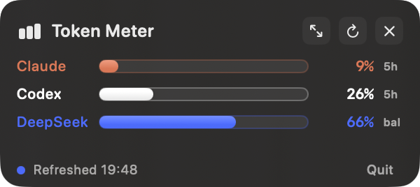

# Token Meter

A tiny macOS menu-bar widget that shows how much of your Claude, Codex, and
DeepSeek allowance you have used — as live percentages, not token guesses.

**Site:** https://huang-zi-zheng-22.github.io/token-meter/



## Install

Requires macOS 14 and Xcode command-line tools (`swift`).

```bash
git clone https://github.com/huang-zi-zheng-22/token-meter.git
cd token-meter
./scripts/install.sh
```

The script runs the self-test, builds the app into `~/Applications/Token Usage
Widget.app`, and registers a LaunchAgent so the widget starts at login.
Refresh: every 3 minutes, on showing the panel, and via the refresh button.

Click the bar-chart icon in the menu bar to show or hide the panel. The panel
floats above regular windows and follows you across Spaces. **Quit** stops it
for the current login session; the LaunchAgent starts it again after the next
login.

## Two sizes

The panel opens **compact** (300 × 134): header, the three bars, and one status
line. The arrows button in the header expands it to the **full** layout
(438 × 384), which adds the per-provider detail rows, and shrinks it again. The
choice is remembered across launches, and resizing keeps the panel's top-left
corner where it was. In compact mode a plan or balance warning that would
otherwise only appear in a detail row is shown in the footer instead.

## What the bars mean

Every bar is **percentage used** of a live, provider-reported allowance — there
are no manual token caps.

- **Claude** — subscription plan utilization from Anthropic's OAuth usage
  endpoint (the same numbers Claude Code's `/usage` panel shows). The bar shows
  whichever of the 5-hour and 7-day windows is fuller; the detail row shows
  both and the weekly reset time.
- **Codex** — the `rate_limits` record Codex writes into its local session
  logs (5-hour and 7-day windows, `used_percent`). This is only as fresh as
  the last Codex run; the tag on the row says LIVE, SEEN <time>, or STALE.
- **DeepSeek** — share of the tracked monthly pool already spent, where the
  pool is the live USD balance plus OpenClaw's month-to-date DeepSeek spend.
  The detail row shows the actual balance, spend, and tokens.

Bars turn orange at 75% used and red at 90%. Token counts in the detail rows
are month-to-date sums from local logs, for context only.

## Data sources

- Claude Code logs: `~/.claude/projects/**/*.jsonl`
- Claude plan usage: `https://api.anthropic.com/api/oauth/usage`, authorized
  with the OAuth credential Claude Code keeps in the login Keychain
  (`Claude Code-credentials`)
- OpenClaw Claude and DeepSeek calls: `~/.openclaw/agents/**/sessions/*.jsonl`
- Codex tokens and rate limits: `~/.codex/sessions/**/*.jsonl`
- DeepSeek live balance: `https://api.deepseek.com/user/balance`, using the
  OpenClaw key from `~/.openclaw/agents/*/agent/models.json`

Both credentials are read into memory and sent only to their own provider's
official endpoint. The app never prints, copies, or stores them.

**First launch (and after every rebuild, because the app is ad-hoc signed)
macOS asks whether Token Usage Widget may read the `Claude Code-credentials`
Keychain item — choose "Always Allow".** If it is denied, the Claude row shows
OFFLINE with local token counts only. If the OAuth token has expired, open
Claude Code once to refresh it.

## Build

```bash
./scripts/build-app.sh
```

Runs the self-test, then writes the signed bundle to
`dist/Token Usage Widget.app`. A read-only snapshot of what the collector
sees is available with:

```bash
swiftc -parse-as-library Sources/TokenUsageWidget/UsageCollector.swift scripts/Snapshot.swift -o .build/snap && .build/snap
```
